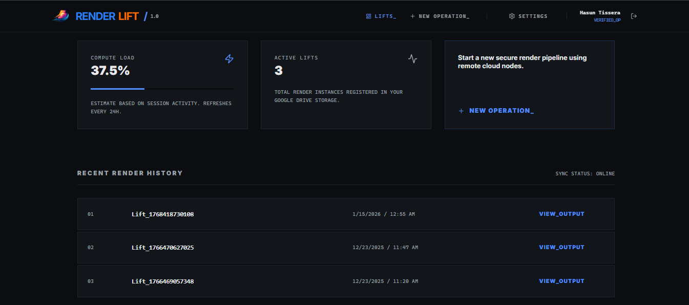

# 🚀 RenderLift

**RenderLift** is a user‑friendly web application for 3D Blender users to upload Blender projects and render them using free Google Cloud GPUs.  

It integrates with **Google Drive** so users can connect and run renders directly from their Drive files — making cloud rendering fast and accessible.

---

## 🌟 Features

- 🔌 Connect with Google Drive via OAuth  
- ☁️ Render Blender `.blend` files using Google Cloud GPU instances  
- 📦 Automatic handling of uploads and downloads to/from Drive  
- 💸 Free (powered by Google Cloud free tiers)  
- 🛠️ Easy UI for managing render jobs

---

## 🧠 Why RenderLift?

RenderLift solves a common problem: rendering large Blender scenes on low‑power machines.  
It gives Blender users access to cloud GPUs without complex setup or paying for expensive services.

---

## 📌 Table of Contents

1. [Demo / Screenshot](#-demo--screenshot)  
2. [Tech Stack](#-tech-stack)  
3. [Getting Started](#-getting-started)  
4. [Configuration](#-configuration)  
5. [Usage](#-usage)  
6. [Contributing](#-contributing)  
7. [License](#-license)

---

## 📸 Demo / Screenshot

Example Markdown:

```markdown

```

---

## 🧱 Tech Stack

- **Next.js** (TypeScript) — Frontend & Backend  
- **NextAuth.js** — Authentication with Google  
- **Google Drive API** — File integration  
- **Google Cloud GPUs** — For rendering Blender files  
- **Blender CLI** — To perform actual rendering

---

## 🧭 Getting Started

### Prerequisites

Make sure you have:

- Node.js (v18+)  
- Docker (optional)  
- Google Cloud project with Drive API enabled

---

### Installation

```bash
git clone https://github.com/Epicer12/RenderLift.git
cd RenderLift
npm install
```

---

## ⚙️ Configuration

Create `.env.local` in your root folder and add:

```env
GOOGLE_CLIENT_ID=your_google_client_id
GOOGLE_CLIENT_SECRET=your_google_secret
NEXTAUTH_SECRET=your_nextauth_secret
GOOGLE_DRIVE_SCOPES="https://www.googleapis.com/auth/drive.file"
```

⚠️ **Never commit `.env.local`** — it contains private credentials.

---

## 🚀 Running the App

Start development server:

```bash
npm run dev
```

Open browser and go to:  
```
http://localhost:3000
```

---

## 📄 Production Deployment

Instructions for production deployment (e.g., Vercel, Render, Cloud Run):

```bash
npm run build
npm run start
```

(You may need to configure environment variables in your deployment provider.)

---

## 🧩 Usage

1. Connect with your **Google account**  
2. Give Drive permission to access your Blender files  
3. Upload / select a `.blend` file  
4. Start rendering on the cloud GPU  
5. Download resulting output files

---

## 🤝 Contributing

We welcome improvements, suggestions, and feature requests!  
To contribute:

1. Fork the project
2. Create a new branch: `git checkout -b feature/your-feature`
3. Commit your changes: `git commit -m "Add some feature"`
4. Push to branch: `git push origin feature/your-feature`
5. Open a Pull Request

See also [CONTRIBUTING.md](CONTRIBUTING.md) for details.

---

## 🧾 License

This project is licensed under the **GNU Affero General Public License v3 (AGPL-3.0)** — see the `LICENSE` file for details.  
Use, modify, and share freely; if this is hosted as a service by someone else, modifications must be published as well.

---

## 📝 Notes

- Update the **Demo Screenshot** once your UI screens are ready.  
- Add a **CONTRIBUTING.md** and **CODE_OF_CONDUCT.md** if you want community contributions.  

---

## 🏠 Trademark Notice

The project name and branding are trademarks of **Hasun Tisera**.  
Forks and derivative works may **not use the project name, logo, or branding** without explicit permission.
